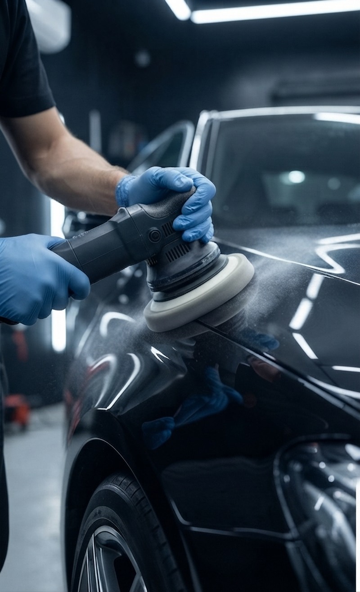
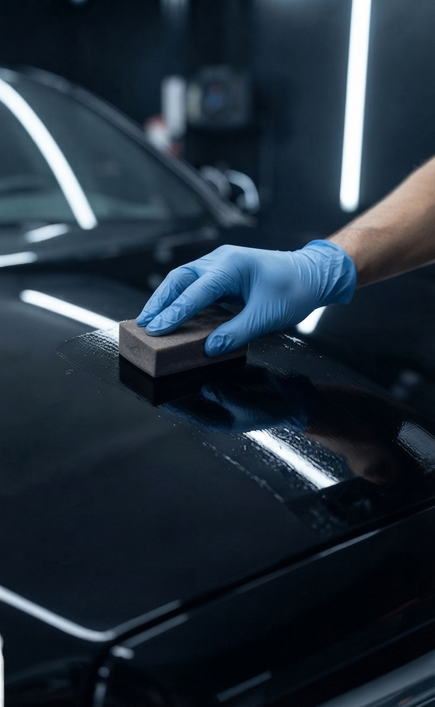

<!DOCTYPE html>
<html lang="ar" dir="rtl" id="html-root">
<head>
  <meta charset="UTF-8" />
  <meta name="viewport" content="width=device-width, initial-scale=1.0" />
  <title>مركز العضايلة للعناية بالسيارات | Adaileh Car Care Center</title>
  <meta name="description" content="مركز العضايلة للعناية بالسيارات في الكرك - وكيل معتمد لمنتجات سينفنكو الألمانية. خدمات دراي كلين، نانوسيراميك 9H، بولش احترافي، تنظيف كتلايزر ومنظومة احتراق." />
  <meta name="keywords" content="دراي كلين سيارات, زيوت سينفنكو الألمانية, محسنات أداء السيارات, تنظيف الكتلايزر, منظومة الاحتراق, بولش سيارات احترافي, نانوسيراميك 9H, مركز العضايلة الكرك" />
  
  <link rel="preconnect" href="https://fonts.googleapis.com">
  <link rel="preconnect" href="https://fonts.gstatic.com" crossorigin>
  <link href="https://fonts.googleapis.com/css2?family=Outfit:wght@300;400;600;700;800&family=Noto+Kufi+Arabic:wght@400;600;700;800;900&display=swap" rel="stylesheet">
  
  
</head>
<body class="selection:bg-electric selection:text-white">

  <!-- Top Contact Bar -->
  

    

      

        📍 الكرك، الأردن
        |
        <a href="tel:+962776999555" class="hover:text-cyber transition font-semibold text-white" dir="ltr">📞 +962 77 699 9555</a>
      

      

        <button onclick="toggleLang()" id="lang-btn" class="bg-electric/20 hover:bg-electric/30 border border-electric/40 text-cyber px-3.5 py-1 rounded-full text-xs font-bold transition">
          English
        </button>
      

    

  

  <!-- Main Sticky Navigation -->
  <header class="sticky top-0 z-50 glass-panel border-b border-white/10">
    

      
      <a href="#" class="flex items-center gap-3.5 group">
        

          <path d=\'M18.92 6.01C18.72 5.42 18.16 5 17.5 5h-11c-.66 0-1.22.42-1.42 1.01L3 12v8c0 .55.45 1 1 1h1c.55 0 1-.45 1-1v-1h12v1c0 .55.45 1 1 1h1c.55 0 1-.45 1-1v-8l-2.08-5.99zM6.85 7h10.29l1.04 3H5.81l1.04-3zM19 17H5v-4.66l.12-.34h13.76l.12.34V17z\'/><circle cx=\'7.5\' cy=\'14.5\' r=\'1.5\'/><circle cx=\'16.5\' cy=\'14.5\' r=\'1.5\'/></svg>'" />
        

        

          
العضايلة للعناية بالسيارات

          
وكيل معتمد لمنتجات سينفنكو الألمانية

        

      </a>

      <nav class="hidden md:flex items-center gap-8 text-sm font-bold text-titanium">
        <a href="#services" class="hover:text-cyber transition" data-en="Services" data-ar="خدماتنا">خدماتنا</a>
        <a href="#ai-advisor" class="hover:text-cyber transition" data-en="Smart Estimator" data-ar="المستشار الذكي والأسعار">المستشار الذكي والأسعار</a>
        <a href="#location" class="hover:text-cyber transition" data-en="Location & Contact" data-ar="الموقع والتواصل">الموقع والتواصل</a>
      </nav>

      

        <a href="#ai-advisor" class="cyber-gradient text-white text-xs sm:text-sm font-bold px-6 py-3 rounded-full shadow-lg shadow-electric/30 hover:opacity-95 transition" data-en="Book Now" data-ar="احجز موعدك الآن">
          احجز موعدك الآن
        </a>
      

    

  </header>

  <!-- Hero Section with Custom "العضايلة" License Plate Car Background -->
  <section class="hero-bg-section min-h-[82vh] flex items-center justify-center py-24 lg:py-32 border-b border-white/10">
    

      
      

        ⚡
        دقة الهندسة الألمانية • لمعان الوكالة الفائق
      

      <h1 class="text-4xl sm:text-6xl lg:text-7xl font-black leading-tight tracking-tight text-white drop-shadow-[0_5px_25px_rgba(0,0,0,0.9)]" data-en="Uncompromising Gloss. Maximum Engine Power." data-ar="فخامة اللمعان.. وقوة الأداء الألماني لسيارتك في الكرك">
        فخامة اللمعان.. وقوة الأداء الألماني لسيارتك في الكرك
      </h1>

      

        من درع النانوسيراميك 9H والبولش الاحترافي، إلى زيوت ومحسنات سينفنكو الألمانية وتنظيف الكتلايزر ومنظومة الاحتراق — نمنح سيارتك عناية استثنائية بأيدي محترفين.
      

      <!-- Hero Call To Action Buttons -->
      

        <a href="#ai-advisor" class="cyber-gradient text-white text-base sm:text-lg font-extrabold px-9 py-4 rounded-full shadow-2xl shadow-electric/40 hover:scale-105 transition duration-300" data-en="Book Your Service Now →" data-ar="احجز خدمتك الآن ←">
          احجز خدمتك الآن ←
        </a>
        <a href="https://wa.me/962776999555" target="_blank" class="glass-panel hover:bg-white/15 border border-cyber/40 text-white text-base sm:text-lg font-bold px-8 py-4 rounded-full transition duration-300 flex items-center gap-2" data-en="💬 Direct WhatsApp" data-ar="💬 تواصل عبر واتساب">
          💬 تواصل عبر واتساب
        </a>
      

    

  </section>

  <!-- Interactive Statistics Section -->
  <section class="py-16 bg-carbon border-b border-white/10 -mt-10 relative z-10 max-w-6xl mx-auto rounded-3xl shadow-2xl px-4">
    

      
      <!-- Stat Card 1 -->
      

        <h4 class="text-5xl sm:text-6xl font-black text-cyber tracking-tight">5+</h4>
        
سنوات من الخبرة والتميز

        ⚡ اضغط لحساب تكلفة باقتك
      

      <!-- Stat Card 2 -->
      

        <h4 class="text-5xl sm:text-6xl font-black text-cyber tracking-tight">100%</h4>
        
مواد ألمانية أصلية ومضمونة

        ⚡ اضغط لحساب تكلفة باقتك
      

      <!-- Stat Card 3 -->
      

        <h4 class="text-5xl sm:text-6xl font-black text-cyber tracking-tight">1500+</h4>
        
سيارة تم العناية بها

        ⚡ اضغط لحساب تكلفة باقتك
      

    

  </section>

  <!-- Core Services Grid (With All Custom Service Photos Integrated) -->
  <section id="services" class="py-24 max-w-7xl mx-auto px-4 sm:px-6 lg:px-8 text-left rtl:text-right">
    

      خدماتنا المتخصصة
      <h2 class="text-3xl sm:text-5xl font-extrabold text-white mt-2" data-en="Our Specialized Services" data-ar="خدمات العناية الفائقة بالمركبات">خدمات العناية الفائقة بالمركبات</h2>
      

        نقدم تشكيلة متكاملة من خدمات العناية بالمحرك والتفصيل الداخلي والخارجي بأعلى المعايير العالمية.
      

    

    

      
      <!-- Service 1: Dry Clean (دراي كلين وتعقيم داخلي فاخر) -->
      

        

          

            
          

          العناية الفاخرة بالمقصورة
          <h3 class="text-xl font-extrabold text-white mt-1" data-en="VIP Interior Dry Clean & Sterilization" data-ar="دراي كلين وتعقيم داخلي فاخر">دراي كلين وتعقيم داخلي فاخر</h3>
          

            تنظيف وتعقيم داخلي عميق بالبخار والأوزون للمقاعد، الأرضيات، والسقف لإزالة البقع الصعبة والروائح الكريهة واستعادة انتعاش الوكالة.
          

        

        

          تعقيم شامل بالبخار والأوزون
          <a href="#ai-advisor" onclick="selectServiceInAdvisor('detail')" class="text-cyber font-bold hover:underline" data-en="Book Now →" data-ar="احجز الآن ←">احجز الآن ←</a>
        

      

      <!-- Service 2: German Senfineco Oils (زيوت سينفنكو الألمانية المعتمدة) -->
      

        

          

            
          

          الهندسة الألمانية الأصلية
          <h3 class="text-xl font-extrabold text-white mt-1" data-en="German Senfineco Motor Oils" data-ar="زيوت سينفنكو الألمانية المعتمدة">زيوت سينفنكو الألمانية المعتمدة</h3>
          

            توفير وفحص زيوت محركات سينفنكو الألمانية الأصلية لضمان ثبات حراري فائق، تقليل الاحتكاك، وأقصى حماية وعمر افتراضي للمحرك.
          

        

        

          وكيل معتمد - ألماني أصلي
          <a href="#ai-advisor" onclick="selectServiceInAdvisor('oils')" class="text-cyber font-bold hover:underline" data-en="Book Now →" data-ar="احجز الآن ←">احجز الآن ←</a>
        

      

      <!-- Service 3: Performance Additives (محسنات أداء وعزم المحرك) -->
      

        

          

            
          

          طاقة وكفاءة مضاعفة
          <h3 class="text-xl font-extrabold text-white mt-1" data-en="Advanced Performance Additives" data-ar="محسنات أداء وعزم المحرك">محسنات أداء وعزم المحرك</h3>
          

            مواد وإضافات ألمانية متطورة لتقليل الاحتكاك، تنظيف نظام الوقود، واستعادة عزم وسرعة استجابة المحرك مع توفير استهلاك الوقود.
          

        

        

          استعادة عزم وسرعة السيارة
          <a href="#ai-advisor" onclick="selectServiceInAdvisor('additives')" class="text-cyber font-bold hover:underline" data-en="Book Now →" data-ar="احجز الآن ←">احجز الآن ←</a>
        

      

      <!-- Service 4: Catalytic Converter Cleaning (تنظيف وعلاج الكتلايزر المتطور) -->
      

        

          

            
          

          صيانة نظام العادم والبيئة
          <h3 class="text-xl font-extrabold text-white mt-1" data-en="Catalytic Converter Deep Cleaning" data-ar="تنظيف وعلاج الكتلايزر المتطور">تنظيف وعلاج الكتلايزر المتطور</h3>
          

            خدمة متخصصة لتنظيف وتفكيك الترسبات الكربونية من الكتلايزر ودبة البيئة لتحسين عزم السيارة، تقليل الانبعاثات، وحل مشاكل Check Engine.
          

        

        

          إزالة الكربون واستعادة العزم
          <a href="#ai-advisor" onclick="selectServiceInAdvisor('catalytic')" class="text-cyber font-bold hover:underline" data-en="Book Now →" data-ar="احجز الآن ←">احجز الآن ←</a>
        

      

      <!-- Service 5: Combustion System Service (خدمة منظومة الاحتراق الشاملة) -->
      

        

          

            
          

          تنقية غرفة الاحتراق
          <h3 class="text-xl font-extrabold text-white mt-1" data-en="Combustion Chamber & Valve Service" data-ar="خدمة منظومة الاحتراق الشاملة">خدمة منظومة الاحتراق الشاملة</h3>
          

            تنظيف وصيانة شاملة للبخاخات، الصمامات، وغرفة الاحتراق بأحدث الأجهزة لضمان احتراق مثالي وأداء سلس واستهلاك اقتصادي للوقود.
          

        

        

          احتراق مثالي وتوفير وقود
          <a href="#ai-advisor" onclick="selectServiceInAdvisor('combustion')" class="text-cyber font-bold hover:underline" data-en="Book Now →" data-ar="احجز الآن ←">احجز الآن ←</a>
        

      

      <!-- Service 6: Professional Polish (بولش وتصحيح طلاء احترافي) -->
      

        

          

            
          

          استعادة لمعة الوكالة
          <h3 class="text-xl font-extrabold text-white mt-1" data-en="Multi-Stage Professional Polish" data-ar="بولش وتصحيح طلاء احترافي">بولش وتصحيح طلاء احترافي</h3>
          

            تلميع ومعالجة خارجية احترافية على عدة مراحل لإزالة دوائر الغسيل، الخدوش السطحية، والأكسدة وإعادة لمعة المرآة الأصلية للطلاء.
          

        

        

          لمعان مرآتي خالٍ من الدوائر
          <a href="#ai-advisor" onclick="selectServiceInAdvisor('polish')" class="text-cyber font-bold hover:underline" data-en="Book Now →" data-ar="احجز الآن ←">احجز الآن ←</a>
        

      

      <!-- Service 7: Nano-Ceramic (نانوسيراميك حماية طلاء 9H) -->
      

        

          

            
          

          الدرع الكريستالي الفائق
          <h3 class="text-2xl font-extrabold text-white mt-1" data-en="9H Nano-Ceramic Armor Coating" data-ar="نانوسيراميك حماية طلاء 9H">نانوسيراميك حماية طلاء 9H</h3>
          

            طبقة حماية كريستالية متطورة (9H) تمنح هيكل السيارة لمعاناً فائقاً، خاصية طرد المياه والأوساخ (هيدروفوبيك)، ومقاومة عالية للأكسدة والعوامل الجوية.
          

        

        

          حماية كريستالية 9H ومقاومة للمياه
          <a href="#ai-advisor" onclick="selectServiceInAdvisor('ceramic')" class="text-cyber font-bold hover:underline" data-en="Book Now →" data-ar="احجز الآن ←">احجز الآن ←</a>
        

      

    

  </section>

  <!-- Intelligent Package Recommender & Estimator Section -->
  <section id="ai-advisor" class="py-24 bg-carbon border-y border-white/10 text-left rtl:text-right">
    

      

        المستشار الذكي لاختيار الباقة
        <h2 class="text-3xl sm:text-5xl font-extrabold text-white mt-3" data-en="Design the Ideal Care Package for Your Car in Seconds" data-ar="صمّم باقة العناية المثالية لسيارتك خلال ثوانٍ">
          صمّم باقة العناية المثالية لسيارتك خلال ثوانٍ
        </h2>
      

      

        
        <!-- Inputs -->
        

          

            <label class="block text-sm font-bold uppercase text-titanium mb-3" data-en="1. Select Vehicle Category:" data-ar="1. اختر فئة وحجم السيارة:">1. اختر فئة وحجم السيارة:</label>
            <select id="car-size" onchange="calculateSmartQuote()" class="w-full p-4 rounded-2xl bg-obsidian text-white text-base font-semibold focus:border-electric focus:outline-none">
              <option value="1.0" data-en="Sedan / Coupe / Hatchback" data-ar="صالون / هاتشباك (Sedan / Hatchback)">صالون / هاتشباك (Sedan / Hatchback)</option>
              <option value="1.25" data-en="Mid-Size SUV / Crossover" data-ar="جيب وسط / كروس أوفر (Mid-Size SUV)">جيب وسط / كروس أوفر (Mid-Size SUV)</option>
              <option value="1.45" data-en="Large SUV / 4x4 / Pickup" data-ar="دفع رباعي كبير / بكب (Large SUV / 4x4)">دفع رباعي كبير / بكب (Large SUV / 4x4)</option>
            </select>
          

          

            <label class="block text-sm font-bold uppercase text-titanium mb-3" data-en="2. Select Primary Treatment:" data-ar="2. اختر الباقة أو الخدمة الأساسية:">2. اختر الباقة أو الخدمة الأساسية:</label>
            <select id="service-type" onchange="calculateSmartQuote()" class="w-full p-4 rounded-2xl bg-obsidian text-white text-base font-semibold focus:border-electric focus:outline-none">
              <option value="detail" data-en="VIP Interior Dry Clean & Sterilization" data-ar="دراي كلين وتعقيم داخلي فاخر">دراي كلين وتعقيم داخلي فاخر</option>
              <option value="oils" data-en="German Senfineco Motor Oils" data-ar="زيوت سينفنكو الألمانية المعتمدة">زيوت سينفنكو الألمانية المعتمدة</option>
              <option value="additives" data-en="Advanced Performance Additives" data-ar="محسنات أداء وعزم المحرك">محسنات أداء وعزم المحرك</option>
              <option value="catalytic" data-en="Catalytic Converter Deep Cleaning" data-ar="تنظيف وعلاج الكتلايزر المتطور">تنظيف وعلاج الكتلايزر المتطور</option>
              <option value="combustion" data-en="Combustion Chamber & Valve Service" data-ar="خدمة منظومة الاحتراق الشاملة">خدمة منظومة الاحتراق الشاملة</option>
              <option value="polish" data-en="Multi-Stage Professional Polish" data-ar="بولش وتصحيح طلاء احترافي">بولش وتصحيح طلاء احترافي</option>
              <option value="ceramic" selected data-en="9H Nano-Ceramic Armor Coating" data-ar="نانوسيراميك حماية طلاء 9H">نانوسيراميك حماية طلاء 9H</option>
            </select>
          

          

            <label class="block text-sm font-bold uppercase text-titanium mb-3" data-en="3. Your Vehicle Make & Model (Optional):" data-ar="3. نوع وموديل السيارة (اختياري):">3. نوع وموديل السيارة (اختياري):</label>
            <input id="car-model" type="text" placeholder="e.g., BMW X5 / Mercedes E-Class / Toyota Camry" class="w-full p-4 rounded-2xl bg-obsidian text-white text-base focus:border-electric focus:outline-none placeholder:text-gray-500" />
          

        

        <!-- Result Card -->
        

          

            

              

                الباقة المقترحة لسيارتك
                <h3 id="quote-title" class="text-2xl sm:text-3xl font-extrabold text-white mt-1">نانوسيراميك حماية طلاء 9H</h3>
              

              ⏱️ 1–2 يوم
            

            

              طبقة نانوسيراميك جزيئية صلبة (9H) توفر درع حماية هيدروفوبيك دائم ضد أشعة الشمس، الأمطار الحمضية، والعوامل البيئية القاسية.
            

            

              

                السعر التقديري يبدأ من
                150 دينار
              

              

                ✓ فحص مجاني للسيارة قبل البدء
              

            

            

              <button onclick="bookViaWhatsApp()" class="cyber-gradient text-white font-bold py-4 px-5 rounded-2xl text-sm shadow-lg hover:opacity-95 transition flex items-center justify-center gap-2">
                💬
                احجز هذه الباقة عبر واتساب
              </button>
              <a href="https://www.facebook.com/AdailehCarCare" target="_blank" rel="noopener noreferrer" class="bg-white/10 hover:bg-white/20 text-white font-bold py-4 px-5 rounded-2xl text-sm transition flex items-center justify-center gap-2">
                📘
                استفسر عبر صفحة فيسبوك
              </a>
            

          

        

      

    

  </section>

  <!-- Location, Hours & Direct Contact Section -->
  <section id="location" class="py-20 max-w-7xl mx-auto px-4 sm:px-6 lg:px-8 text-left rtl:text-right">
    

      
      

        

          تفضل بزيارة مركزنا
          <h2 class="text-3xl font-extrabold text-white" data-en="Location & Direct Contact" data-ar="الموقع وأرقام التواصل">الموقع وأرقام التواصل</h2>
          

            تفضل بزيارتنا للحصول على منتجات سينفنكو الألمانية وخدمات العناية الشاملة بالسيارات في الكرك.
          

          

            

              📍
              

                
العنوان

                
الأردن، الكرك — مركز العضايلة للعناية بالسيارات

              

            

            

              📞
              

                
الهاتف والواتساب المباشر

                <a href="tel:+962776999555" class="text-cyber font-bold hover:underline" dir="ltr">+962 77 699 9555</a>
              

            

            

              🕒
              

                
ساعات العمل

                
يومياً من الساعة 9:00 صباحاً حتى 9:00 مساءً

              

            

          

        

        

          <a href="https://wa.me/962776999555?text=مرحباً%20مركز%20العضايلة،%20أود%20الاستفسار" target="_blank" class="w-full cyber-gradient text-center py-3.5 rounded-xl text-xs font-bold text-white shadow-lg" data-en="💬 Contact via WhatsApp" data-ar="💬 تواصل عبر واتساب">
            💬 تواصل عبر واتساب
          </a>
        

      

      

        <iframe
          title="Adaileh Car Care Map"
          src="https://www.google.com/maps?q=Al-Karak,Jordan&output=embed"
          class="w-full h-full min-h-[380px] border-0 grayscale invert opacity-90 contrast-125"
          loading="lazy">
        </iframe>
      

    

  </section>

  <!-- Footer -->
  <footer class="bg-obsidian border-t border-white/10 py-10 text-center text-xs text-titanium">
    

      

        © 2026 مركز العضايلة للعناية بالمركبات - الكرك. جميع الحقوق محفوظة.
      

      

        <a href="tel:+962776999555" class="hover:text-cyber transition">0776999555</a>
        <a href="#services" class="hover:text-cyber transition" data-en="Services" data-ar="الخدمات">الخدمات</a>
      

    

  </footer>

  <script>
    let isArabic = true;
    const WHATSAPP_NUMBER = "962776999555";

    const packageData = {
      "detail": {
        enTitle: "VIP Interior Dry Clean & Sterilization",
        arTitle: "دراي كلين وتعقيم داخلي فاخر",
        enDesc: "Deep multi-stage steam and ozone extraction for seats, carpets, headliners, and dashboard to eliminate stubborn stains and restore freshness.",
        arDesc: "تنظيف وتعقيم داخلي عميق بالبخار والأوزون للمقاعد، الأرضيات، والسقف لإزالة البقع الصعبة والروائح الكريهة واستعادة انتعاش الوكالة.",
        basePrice: 65,
        enTime: "⏱️ 5–7 Hours",
        arTime: "⏱️ 5–7 ساعات"
      },
      "oils": {
        enTitle: "German Senfineco Motor Oils",
        arTitle: "زيوت سينفنكو الألمانية المعتمدة",
        enDesc: "Official German Senfineco synthetic motor oils engineered for extreme thermal stability, reduced friction, and maximum engine lifespan.",
        arDesc: "توفير وفحص زيوت محركات سينفنكو الألمانية الأصلية لضمان ثبات حراري فائق، تقليل الاحتكاك، وأقصى حماية وعمر افتراضي للمحرك.",
        basePrice: 45,
        enTime: "⏱️ 1 Hour",
        arTime: "⏱️ ساعة واحدة"
      },
      "additives": {
        enTitle: "Advanced Performance Additives",
        arTitle: "محسنات أداء وعزم المحرك",
        enDesc: "High-grade German chemical additives designed to clean fuel injectors, boost horsepower, and optimize fuel economy instantly.",
        arDesc: "مواد وإضافات ألمانية متطورة لتقليل الاحتكاك، تنظيف نظام الوقود، واستعادة عزم وسرعة استجابة المحرك.",
        basePrice: 30,
        enTime: "⏱️ 30 Mins",
        arTime: "⏱️ 30 دقيقة"
      },
      "catalytic": {
        enTitle: "Catalytic Converter Deep Cleaning",
        arTitle: "تنظيف وعلاج الكتلايزر المتطور",
        enDesc: "Specialized chemical and steam treatment to dissolve carbon buildup, clear exhaust restrictions, and resolve check-engine issues.",
        arDesc: "خدمة متخصصة لتنظيف وتفكيك الترسبات الكربونية من الكتلايزر لتحسين عزم السيارة وتقليل الانبعاثات.",
        basePrice: 50,
        enTime: "⏱️ 2 Hours",
        arTime: "⏱️ ساعتان"
      },
      "combustion": {
        enTitle: "Combustion Chamber & Valve Service",
        arTitle: "خدمة منظومة الاحتراق الشاملة",
        enDesc: "Professional carbon decarbonization for intake valves, combustion chambers, and fuel systems to ensure optimal engine performance.",
        arDesc: "تنظيف وصيانة شاملة للبخاخات، الصمامات، وغرفة الاحتراق لضمان احتراق مثالي واستهلاك اقتصادي للوقود.",
        basePrice: 40,
        enTime: "⏱️ 1–2 Hours",
        arTime: "⏱️ 1–2 ساعة"
      },
      "polish": {
        enTitle: "Multi-Stage Professional Polish",
        arTitle: "بولش وتصحيح طلاء احترافي",
        enDesc: "Precision multi-stage machine compounding to eliminate swirl marks, oxidation, and scratches, bringing back a deep mirror gloss.",
        arDesc: "تلميع ومعالجة خارجية على عدة مراحل لإزالة دوائر الغسيل، الخدوش السطحية، وإعادة لمعة الوكالة للطلاء.",
        basePrice: 90,
        enTime: "⏱️ 1 Day",
        arTime: "⏱️ يوم واحد"
      },
      "ceramic": {
        enTitle: "9H Nano-Ceramic Armor Coating",
        arTitle: "نانوسيراميك حماية طلاء 9H",
        enDesc: "Permanent 9H molecular bond providing extreme hydrophobic protection against UV rays, acid rain, bird droppings, and harsh weather.",
        arDesc: "طبقة حماية كريستالية متطورة (9H) تمنح هيكل السيارة لمعاناً فائقاً ومقاومة عالية للأكسدة والعوامل الجوية.",
        basePrice: 150,
        enTime: "⏱️ 1–2 Days",
        arTime: "⏱️ 1–2 يوم"
      }
    };

    function selectServiceInAdvisor(serviceKey) {
      const selectEl = document.getElementById('service-type');
      selectEl.value = serviceKey;
      calculateSmartQuote();
    }

    function calculateSmartQuote() {
      const sizeMultiplier = parseFloat(document.getElementById('car-size').value);
      const serviceKey = document.getElementById('service-type').value;
      const pkg = packageData[serviceKey];

      const finalPrice = Math.round(pkg.basePrice * sizeMultiplier);
      document.getElementById('quote-title').textContent = isArabic ? pkg.arTitle : pkg.enTitle;
      document.getElementById('quote-desc').textContent = isArabic ? pkg.arDesc : pkg.enDesc;
      document.getElementById('quote-time').textContent = isArabic ? pkg.arTime : pkg.enTime;
      document.getElementById('quote-price').textContent = finalPrice + (isArabic ? " دينار" : " JOD");
    }

    function bookViaWhatsApp() {
      const serviceKey = document.getElementById('service-type').value;
      const pkg
