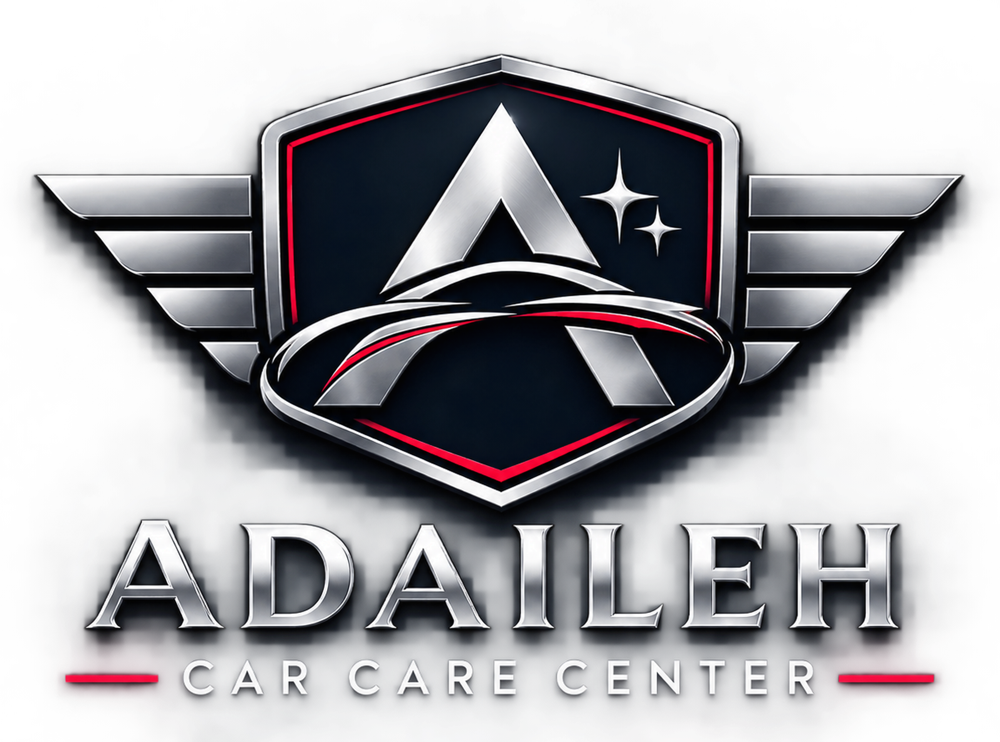

<!DOCTYPE html>
<html lang="en" dir="ltr" id="html-root">
<head>
  <meta charset="UTF-8" />
  <meta name="viewport" content="width=device-width, initial-scale=1.0" />
  <title>Adaileh Car Care Center | العدايلة للعناية بالسيارات</title>
  
  <link rel="preconnect" href="https://fonts.googleapis.com">
  <link rel="preconnect" href="https://fonts.gstatic.com" crossorigin>
  <link href="https://fonts.googleapis.com/css2?family=Outfit:wght@300;400;600;700;800&family=Noto+Kufi+Arabic:wght@400;600;700;800&display=swap" rel="stylesheet">
  
  
</head>
<body class="selection:bg-electric selection:text-white">

  <!-- Top Contact & Social Bar -->
  

    

      

        📍 Amman, Jordan
        |
        <a href="tel:+962790000000" class="hover:text-cyber transition font-semibold text-white">📞 +962 79 000 0000</a>
      

      

        <a href="https://www.facebook.com/AdailehCarCare" target="_blank" rel="noopener noreferrer" class="text-electric hover:text-cyber font-semibold flex items-center gap-1.5 transition">
          📘
          Follow us on Facebook
        </a>
        <button onclick="toggleLang()" id="lang-btn" class="bg-white/10 hover:bg-white/20 text-white px-3 py-1 rounded-full text-xs font-bold transition">
          العربية
        </button>
      

    

  

  <!-- Main Sticky Navigation -->
  <header class="sticky top-0 z-50 glass-panel border-b border-white/10">
    

      
      <a href="#" class="flex items-center gap-3.5 group">
        

          <path d=\'M18.92 6.01C18.72 5.42 18.16 5 17.5 5h-11c-.66 0-1.22.42-1.42 1.01L3 12v8c0 .55.45 1 1 1h1c.55 0 1-.45 1-1v-1h12v1c0 .55.45 1 1 1h1c.55 0 1-.45 1-1v-8l-2.08-5.99zM6.85 7h10.29l1.04 3H5.81l1.04-3zM19 17H5v-4.66l.12-.34h13.76l.12.34V17z\'/><circle cx=\'7.5\' cy=\'14.5\' r=\'1.5\'/><circle cx=\'16.5\' cy=\'14.5\' r=\'1.5\'/></svg>'" />
        

        

          
ADAILEH CAR CARE

          
International Detailing Studio

        

      </a>

      <nav class="hidden md:flex items-center gap-7 text-sm font-semibold text-titanium">
        <a href="#services" class="hover:text-white transition" data-en="Services" data-ar="خدماتنا">Services</a>
        <a href="#ai-advisor" class="hover:text-white transition" data-en="Smart Price Estimator" data-ar="المستشار الذكي والأسعار">Smart Price Estimator</a>
        <a href="#location" class="hover:text-white transition" data-en="Location & Contact" data-ar="الموقع والتواصل">Location & Contact</a>
      </nav>

      

        <a href="#ai-advisor" class="cyber-gradient text-white text-xs sm:text-sm font-bold px-5 py-2.5 rounded-full shadow-lg shadow-electric/25 hover:opacity-95 transition" data-en="Book Appointment" data-ar="احجز موعدك الآن">
          Book Appointment
        </a>
      

    

  </header>

  <!-- Hero Section -->
  <section class="relative overflow-hidden py-20 lg:py-28 border-b border-white/10" style="background: radial-gradient(circle at 80% 20%, rgba(0, 168, 255, 0.18), transparent 50%), linear-gradient(180deg, #0B0D12 0%, #131722 100%);">
    

      
      

        

          ⚡
          Precision Automotive Aesthetics & Protection
        

        <h1 class="text-4xl sm:text-6xl font-extrabold leading-tight tracking-tight text-white" data-en="Uncompromising Gloss. Engineered Protection." data-ar="لمعان لا مثيل له. حماية هندسية فائقة لسيارتك.">
          Uncompromising Gloss. Engineered Protection.
        </h1>
        

          At Adaileh Car Care, we combine German & American surface chemistry, 9H Nano-Ceramic technology, and self-healing PPF with master craftsmanship to keep your vehicle in showroom condition.
        

        

          <a href="#ai-advisor" class="cyber-gradient text-white font-bold px-8 py-4 rounded-full shadow-xl shadow-electric/25 hover:opacity-95 transition" data-en="Launch Smart Package Advisor →" data-ar="ابدأ فحص الباقة الذكي لسيارتك ←">
            Launch Smart Package Advisor →
          </a>
          <a href="https://www.facebook.com/AdailehCarCare" target="_blank" rel="noopener noreferrer" class="bg-white/5 hover:bg-white/10 border border-white/15 text-white font-semibold px-7 py-4 rounded-full transition" data-en="View Our Work on Facebook" data-ar="شاهد أعمالنا على فيسبوك">
            View Our Work on Facebook
          </a>
        

        

          

            
9H+

            
Ceramic Hardness

          

          

            
10 Yrs

            
PPF Warranty

          

          

            
100%

            
Swirl-Free Guarantee

          

        

      

      <!-- Featured Emblem Card -->
      

        

          
          

            <path d=\'M18.92 6.01C18.72 5.42 18.16 5 17.5 5h-11c-.66 0-1.22.42-1.42 1.01L3 12v8c0 .55.45 1 1 1h1c.55 0 1-.45 1-1v-1h12v1c0 .55.45 1 1 1h1c.55 0 1-.45 1-1v-8l-2.08-5.99zM6.85 7h10.29l1.04 3H5.81l1.04-3zM19 17H5v-4.66l.12-.34h13.76l.12.34V17z\'/><circle cx=\'7.5\' cy=\'14.5\' r=\'1.5\'/><circle cx=\'16.5\' cy=\'14.5\' r=\'1.5\'/></svg>'" />
          

          

            

              

                
9H Graphene & Ceramic Coating

              

              3–5 Yr Warranty
            

            

              

                
Self-Healing PPF Armor

              

              TPU Optical Clear
            

          

          

            <a href="tel:+962790000000" class="flex-1 bg-white/10 hover:bg-white/15 text-center py-3 rounded-xl text-xs font-bold text-white transition" data-en="📞 Call Direct" data-ar="📞 اتصال مباشر">
              📞 Call Direct
            </a>
            <a href="https://www.facebook.com/AdailehCarCare" target="_blank" rel="noopener noreferrer" class="flex-1 cyber-gradient text-center py-3 rounded-xl text-xs font-bold text-white transition" data-en="📘 Message on Facebook" data-ar="📘 راسلنا على فيسبوك">
              📘 Message on Facebook
            </a>
          

        

      

    

  </section>

  <!-- Core Services Grid -->
  <section id="services" class="py-20 max-w-7xl mx-auto px-4 sm:px-6 lg:px-8 text-left rtl:text-right">
    

      International Car Care Standards
      <h2 class="text-3xl sm:text-5xl font-extrabold text-white mt-2" data-en="Bespoke Automotive Treatments" data-ar="حلول متكاملة للعناية بسيارتك وحمايتها">Bespoke Automotive Treatments</h2>
      

        Every vehicle undergoes a multi-point LED paint inspection and pH-neutral decontamination before treatment.
      

    

    

      

        

          
🛡️

          Surface Armor
          <h3 class="text-xl font-bold text-white mt-1" data-en="Paint Protection Film (PPF)" data-ar="أفلام الحماية الشفافة (PPF)">Paint Protection Film (PPF)</h3>
          

            Aliphatic TPU film that absorbs rock chips, road debris, and minor abrasions with heat-activated self-healing technology.
          

        

        

          Full Body / Front Bikini
          <a href="#ai-advisor" class="text-electric font-bold hover:underline" data-en="Configure →" data-ar="احسب التكلفة ←">Configure →</a>
        

      

      

        

          
💎

          Liquid Glass
          <h3 class="text-xl font-bold text-white mt-1" data-en="9H Nano-Ceramic & Graphene" data-ar="نانو سيراميك وجرافين (9H)">9H Nano-Ceramic & Graphene</h3>
          

            Permanent chemical bond creating extreme hydrophobic water-beading, UV oxidation defense, and deep candy-like gloss.
          

        

        

          Multi-Layer Application
          <a href="#ai-advisor" class="text-electric font-bold hover:underline" data-en="Configure →" data-ar="احسب التكلفة ←">Configure →</a>
        

      

      

        

          
✨

          Showroom Restoration
          <h3 class="text-xl font-bold text-white mt-1" data-en="Multi-Stage Paint Correction" data-ar="تصحيح الطلاء وبولش على عدة مراحل">Multi-Stage Paint Correction</h3>
          

            Precision machine compounding and jewel-polishing to safely eliminate up to 95% of swirl marks, holograms, and oxidation.
          

        

        

          Digital Paint Gauge Safe
          <a href="#ai-advisor" class="text-electric font-bold hover:underline" data-en="Configure →" data-ar="احسب التكلفة ←">Configure →</a>
        

      

      

        

          
🛋️

          Cabin Sanctuary
          <h3 class="text-xl font-bold text-white mt-1" data-en="VIP Interior Detailing & Steam" data-ar="دراي كلين تفصيلي وتعقيم بالبخار">VIP Interior Detailing & Steam</h3>
          

            Deep extraction of carpets, Alcantara & Nappa leather conditioning, AC vent ozone sterilization, and matte UV dashboard protection.
          

        

        

          Anti-Bacterial & Odor Free
          <a href="#ai-advisor" class="text-electric font-bold hover:underline" data-en="Configure →" data-ar="احسب التكلفة ←">Configure →</a>
        

      

      

        

          
☀️

          Thermal Control
          <h3 class="text-xl font-bold text-white mt-1" data-en="Nano-Ceramic Window Tint" data-ar="تظليل عازل حراري نانو سيراميك">Nano-Ceramic Window Tint</h3>
          

            Blocks up to 99% of harmful UV rays and high infrared solar heat while maintaining crystal-clear night visibility and GPS signal.
          

        

        

          Jordan Traffic Law Compliant
          <a href="#ai-advisor" class="text-electric font-bold hover:underline" data-en="Configure →" data-ar="احسب التكلفة ←">Configure →</a>
        

      

      

        

          
⚙️

          Precision Details
          <h3 class="text-xl font-bold text-white mt-1" data-en="Engine Bay, Rim & Caliper Care" data-ar="تنظيف المحرك، الجنطات والضواو">Engine Bay, Rim & Caliper Care</h3>
          

            Safe dielectric engine detailing, iron brake-dust decontamination on alloy wheels, and crystal headlight restoration.
          

        

        

          Hybrid & EV Safe
          <a href="#ai-advisor" class="text-electric font-bold hover:underline" data-en="Configure →" data-ar="احسب التكلفة ←">Configure →</a>
        

      

    

  </section>

  <!-- Intelligent Package Recommender & Estimator -->
  <section id="ai-advisor" class="py-20 bg-carbon border-y border-white/10 text-left rtl:text-right">
    

      

        
        

          Intelligent Car Care Configurator
          <h2 class="text-3xl sm:text-4xl font-extrabold text-white" data-en="Find the Exact Treatment Your Car Needs" data-ar="صمّم باقة العناية المثالية لسيارتك خلال ثوانٍ">
            Find the Exact Treatment Your Car Needs
          </h2>

          

            

              <label class="block text-xs font-bold uppercase text-titanium mb-2" data-en="1. Select Vehicle Category:" data-ar="1. اختر فئة وحجم السيارة:">1. Select Vehicle Category:</label>
              <select id="car-size" onchange="calculateSmartQuote()" class="w-full p-3.5 rounded-xl bg-obsidian border border-white/15 text-white text-sm font-semibold focus:border-electric focus:outline-none">
                <option value="1.0">Sedan / Coupe / Hatchback (صالون / هاتشباك)</option>
                <option value="1.25">Mid-Size SUV / Crossover (جيب وسط / كروس أوفر)</option>
                <option value="1.45">Large SUV / 4x4 / Pickup (دفع رباعي كبير / بكب)</option>
              </select>
            

            

              <label class="block text-xs font-bold uppercase text-titanium mb-2" data-en="2. Select Primary Treatment:" data-ar="2. اختر الباقة أو الخدمة الأساسية:">2. Select Primary Treatment:</label>
              <select id="service-type" onchange="calculateSmartQuote()" class="w-full p-3.5 rounded-xl bg-obsidian border border-white/15 text-white text-sm font-semibold focus:border-electric focus:outline-none">
                <option value="detail">VIP Full Interior & Exterior Detailing (دراي كلين شاملة + بولش خارجي)</option>
                <option value="ceramic" selected>9H Nano-Ceramic Package + Paint Correction (نانو سيراميك + تصحيح طلاء)</option>
                <option value="ppf-front">Front-End Self-Healing PPF Package (أفلام حماية لمقدمة السيارة)</option>
                <option value="ppf-full">Full-Body Self-Healing PPF Armor (حماية شفافة كاملة للسيارة)</option>
                <option value="tint">Nano-Ceramic Thermal Window Tint (عازل حراري نانو سيراميك)</option>
              </select>
            

            

              <label class="block text-xs font-bold uppercase text-titanium mb-2" data-en="3. Your Vehicle Make & Model (Optional):" data-ar="3. نوع وموديل السيارة (اختياري):">3. Your Vehicle Make & Model (Optional):</label>
              <input id="car-model" type="text" placeholder="e.g., BMW X5 2025 / Kia EV6 / Mercedes E-Class" class="w-full p-3.5 rounded-xl bg-obsidian border border-white/15 text-white text-sm focus:border-electric focus:outline-none" />
            

          

        

        

          

            

              

                Recommended Protocol
                <h3 id="quote-title" class="text-2xl font-extrabold text-white mt-1">9H Nano-Ceramic Shield</h3>
              

              ⏱️ 1–2 Days
            

            

              Includes foam decontamination, clay-bar treatment, 2-stage machine polish to remove swirls, and multi-layer 9H ceramic coating on paint, rims, and glass.
            

            

              

                Estimated Starting Investment
                150 JOD
              

              

                ✓ Free LED Paint Inspection
              

            

            

              <button onclick="bookViaWhatsApp()" class="cyber-gradient text-white font-bold py-4 px-5 rounded-xl text-xs sm:text-sm shadow-lg hover:opacity-95 transition flex items-center justify-center gap-2">
                💬
                Book This Package on WhatsApp
              </button>
              <a href="https://www.facebook.com/AdailehCarCare" target="_blank" rel="noopener noreferrer" class="bg-white/10 hover:bg-white/20 text-white font-bold py-4 px-5 rounded-xl text-xs sm:text-sm transition flex items-center justify-center gap-2">
                📘
                Inquire via Facebook
              </a>
            

          

        

      

    

  </section>

  <!-- Location & Direct Contact Section -->
  <section id="location" class="py-20 max-w-7xl mx-auto px-4 sm:px-6 lg:px-8 text-left rtl:text-right">
    

      
      

        

          Visit Our Studio
          <h2 class="text-3xl font-extrabold text-white" data-en="Location & Direct Contact" data-ar="الموقع وأرقام التواصل">Location & Direct Contact</h2>
          

            Drop by for a complimentary paint thickness check and consultation with our detailing specialists.
          

          

            

              📍
              

                
Studio Address

                
Amman, Jordan — Adaileh Car Care Center

              

            

            

              📞
              

                
Direct Phone & WhatsApp

                <a href="tel:+962790000000" class="text-cyber font-bold hover:underline">+962 79 000 0000</a>
              

            

            

              🕒
              

                
Working Hours

                
Saturday – Thursday: 9:00 AM – 8:00 PM

              

            

            

              📘
              

                
Official Facebook Page

                <a href="https://www.facebook.com/AdailehCarCare" target="_blank" rel="noopener noreferrer" class="text-cyber font-bold hover:underline">facebook.com/AdailehCarCare</a>
              

            

          

        

        

          <a href="https://www.google.com/maps/search/?api=1&query=Adaileh+Car+Care+Jordan" target="_blank" rel="noopener noreferrer" class="w-full cyber-gradient text-center py-3.5 rounded-xl text-xs font-bold text-white shadow-lg" data-en="🗺️ Open Location in Google Maps" data-ar="🗺️ افتح الموقع على خرائط جوجل (Google Maps)">
            🗺️ Open Location in Google Maps
          </a>
        

      

      

        <iframe
          title="Adaileh Car Care Map"
          src="https://www.google.com/maps?q=Amman,Jordan&output=embed"
          class="w-full h-full min-h-[380px] border-0 grayscale invert opacity-90 contrast-125"
          loading="lazy">
        </iframe>
      

    

  </section>

  <!-- Footer -->
  <footer class="bg-obsidian border-t border-white/10 py-10 text-center text-xs text-titanium">
    

      

        © 2026 ADAILEH CAR CARE CENTER (العدايلة للعناية بالسيارات). All Rights Reserved.
      

      

        <a href="https://www.facebook.com/AdailehCarCare" target="_blank" rel="noopener noreferrer" class="hover:text-cyber transition">Facebook</a>
        <a href="tel:+962790000000" class="hover:text-cyber transition">+962 79 000 0000</a>
        <a href="#services" class="hover:text-cyber transition">Services</a>
      

    

  </footer>

  
</body>
</html>
